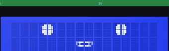
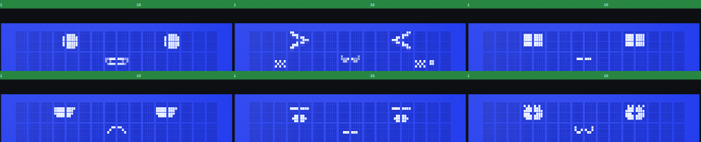
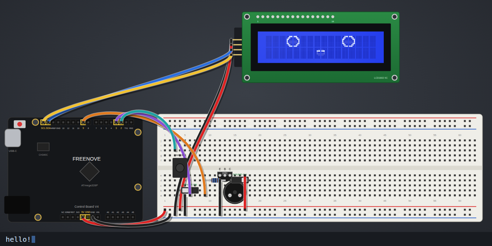

<div align="center">


# G L Y P H

**A living kaomoji face that replaces the "..." typing dots in any AI chat.**

[](LICENSE)
[](package.json)
[](#use--under-5-lines)
[](#use--under-5-lines)
[](https://github.com/Bestdoom20/glyph/pulls)

**[▶ Live Playground](https://bestdoom20.github.io/glyph/)** · [Install](#install) · [API](#api) · [Demo](#demo)

`・_・` &nbsp;→&nbsp; `-_-` &nbsp;→&nbsp; `・o・` &nbsp;→&nbsp; `・ω・` &nbsp;→&nbsp; `^‿^` &nbsp;→&nbsp; `u_u z`

</div>

---

`・_・` breathes, blinks, looks around, follows your cursor, and falls asleep if you ignore it. When your AI generates, it talks — `・o・ ・ω・ ・‿・` — for exactly as long as tokens flow, reacting to what it's saying: `WOW!!` → `O_O!`, an error → `>_< ⚡`, an emoji in the stream gets mirrored on its face.

Zero runtime dependencies. Text + CSS only. **Add a face = add a string.**

## 🆕 GLYPH on real hardware

<div align="center">



**A tiny face on a $3 LCD that talks, feels, listens and reacts. It runs on an Arduino Uno.**

**[🎨 Face Builder](https://bestdoom20.github.io/glyph/face-builder/)** · **[🔬 Kit Lab simulator](https://bestdoom20.github.io/glyph/lab/)** · [How it works](#glyph-lcd--the-face-on-real-hardware) · [Wiring](lcd/WIRING.md)

</div>

- 38 faces across 5 profiles (basic, kawaii, robot, grumpy, brows), plus **your own face**: draw the eyes and the engine derives every expression.
- A buzzer "mumble speech" voice, a feelings engine, LLM token-stream talking, and a Telegram/terminal bridge to Claude.
- A 1:1 browser simulator with a step-by-step build guide. 59% flash on an ATmega328P.

**Coming soon:** text-to-speech voice output · SillyTavern and roleplay integrations (character mood and status meters drive the face) · more expression packs and hardware projects.

## Install

```sh
npm install @bestdoom20/glyph
```

## Use — under 5 lines

```js
import { glyph } from '@bestdoom20/glyph';
const g = glyph.mount(document.querySelector('#face'));
g.think();                                      // 💭 waiting for first token
for await (const chunk of stream) g.say(chunk); // mouth runs while tokens flow
g.done();                                       // idles, blinks, eventually sleeps
```

Or as a web component (React/Vue/Svelte/plain HTML):

```html
<glyph-face state="idle" personality="hyper"></glyph-face>
```

React wrapper:

```jsx
import { Glyph } from '@bestdoom20/glyph/react';
<Glyph state="thinking" engineRef={g => (ref.current = g)} />
```

OpenAI-style streams, one call:

```js
import { drive } from '@bestdoom20/glyph';
await drive(g, openaiStream); // think → say per delta → done
```

Non-streaming API? `reveal(g, fullText)` plays it back word-by-word so the face still lives.

## The cast

<div align="center">

| `・_・` | `˘_˘ 💭` | `・ω・` | `^‿^ ♪` | `♡_♡ ♥` | `O_O !` |
|:---:|:---:|:---:|:---:|:---:|:---:|
| idle | think | talk | happy | love | shock |

| `o_O ?` | `;_;` | `>_< ⚡` | `u_u z` | `¬‿¬` | `@_@` |
|:---:|:---:|:---:|:---:|:---:|:---:|
| confused | sad | error | sleep | smug | dizzy |

</div>

~17 expressions built in. Add your own: one entry in the `EXPRESSIONS` registry — eyes template + mouth frames, `%` marks the mouth slot.

## What it does on its own

- **Breathing + random blinks** — always on, the core "alive" cue
- **Idle director** — look-arounds, winks, hums ♪, sighs; 30s idle → drowsy `˘_˘`; 60s → yawns and sleeps `u_u z`; any activity → startle-wake `0o0 !`
- **Cursor tracking** — face leans toward your pointer; hover → `^‿^`; click → `O_O!` or `^w^`; long-press → `@_@`
- **Talk realism** — pauses on `.` `,`; pops on `!` `?`; slows on `...`; mirrors emoji; local text-cue heuristic flashes happy/shock/error/confused mid-sentence
- **Personalities** — `sleepy` `hyper` `shy` `sassy` (data-only presets)
- Respects `prefers-reduced-motion` — static readable face, no animation

## GLYPH-LCD — the face on real hardware

<div align="center">




**[🎨 Face Builder](https://bestdoom20.github.io/glyph/face-builder/)** · **[🔬 Kit Lab simulator](https://bestdoom20.github.io/glyph/lab/)** · [Wiring](lcd/WIRING.md) · [Voice notes](lcd/VOICE-NOTES.md)

</div>

**Build your own face.** Draw the base eyes in the [Face Builder](https://bestdoom20.github.io/glyph/face-builder/) and send them over USB from the browser (Web Serial), or paste the `:eyes …` command into the Serial Monitor. Glyph stores the face in EEPROM, and the **universal expression engine** derives every expression from your eyes: happy (top-edge arc), surprised (widened), blink (a line as wide as your eye), sleepy and annoyed (lids), angry and sad (corner cuts). Hearts, spirals and stars stay universal. Talking, blinking, glancing, emotions and all 38 faces work on your design with no extra drawing.

**Kit Lab.** A 1:1 browser simulator of the Freenove kit: byte-level PCF8574/HD44780 emulation with the A00 font, I2C bus timing, the same sketch running live (translated from C), the buzzer voice in WebAudio with a buzzer model, clickable switches and button, an interactive build guide (zoom, numbered steps, connection bands) for two layouts, and a parts bin. Run it locally with `python3 lcd/lab/lab_server.py`, then point `glyph_bridge.py --lab` at it.



**The small engine.** Everything below fits an ATmega328P with room to spare: **59% flash, 40% RAM**.
- **No libraries:** its own I2C master and a batched LCD driver (a CGRAM slot in ~3.5 ms, about 4x faster than LiquidCrystal_I2C).
- **Voice:** a 16 kHz wavetable voice ISR with linear interpolation and band-limited vowel tables in flash. A bright buzzer voice is the default; the reference-fitted low hum is one command away.
- **Feelings:** a valence/arousal engine with a word lexicon.
- **Animation:** profile data rows, squash/pop transitions, micro-saccades, and frame skipping when nothing changed.
- **Power:** idle-sleep between frames, and a POWER switch that puts the chip into power-down sleep.


[`lcd/glyph_lcd/glyph_lcd.ino`](lcd/glyph_lcd/glyph_lcd.ino) puts GLYPH on a **1602 I2C LCD** (HD44780 + PCF8574 backpack) driven by an Arduino Uno or clone. 38 faces: `idle happy joy love sad cry shock angry annoyed smug excited dizzy sleepy sleep kiss tongue evil cute confused uwu sparkle owo worried robot robohappy roboalert robosad roboangry grumpy content browidle browhappy browwow browangry browsad browskeptic browtired browcry`.

```
LCD GND -> GND   VCC -> 5V   SDA -> A4   SCL -> A5      library: LiquidCrystal_I2C
Passive buzzer via S8050 NPN: D9 -> 1k -> base, emitter -> GND, collector -> buzzer -, buzzer + -> SOUND switch -> 5V
SOUND slide switch: middle -> buzzer +, side -> 5V (hardware mute)
POWER slide switch: middle -> D3, side -> GND (off = screen dark + ATmega power-down sleep)
MODE push button: one leg -> D2, other leg -> GND (press = next mode)
```

**Alive, not scripted.** A two-axis feeling (valence sad↔happy, arousal calm↔excited) drifts back to each mode's resting point. Words push it, through a small lexicon of how each word moves the two axes and what kind of word it is. The face is picked from that feeling per mode, and has to hold 250 ms so it doesn't flicker. The feeling also drives body language: blink rate and blink speed, darting or steady eyes, voice pitch and pace. Praise lifts its resting mood for minutes, being ignored makes it bored and then sleepy, and tired moods yawn. **You vs it:** `> text` is you talking. It stops mid-sentence, nods along per word, then reacts: concern if you're sad, hurt if you're hostile, perks up at its name, curious at questions, startled by CAPS. After a thinking beat, its reply plays in the mood you left it in. `:typing` makes it watch you type, with thinking dots. **Animation:** faces change with anticipation (squash the old face, squash into the new), excited faces pop wide first, eyes make tiny 1 px saccades, and the eyes squint on shouted words.

**LLM bridge** ([`lcd/bridge/glyph_bridge.py`](lcd/bridge/glyph_bridge.py)): chat from the terminal or a Telegram bot. Claude streams the reply, and the face gets `:typing` while it thinks, then your message as a `>` line, then the reply token by token, so it listens, reacts and talks at the model's pace. Point it at the board (`--port /dev/ttyUSB0`) or at the Kit Lab simulator (`--lab http://host:8602`). `--echo` tests the wiring without an LLM.

```
pip install anthropic pyserial
python3 lcd/bridge/glyph_bridge.py --port /dev/ttyUSB0             # chat in the terminal
TELEGRAM_BOT_TOKEN=... python3 lcd/bridge/glyph_bridge.py --port /dev/ttyUSB0 --telegram
```

**Profiles** (`:mode name` or the MODE button): `basic`, `kawaii` (UwU / ✧ / >ω<, permanent blush, a beauty mark on the right cheek, bouncy, higher voice, hums), `robot` (■ eyes, monotone voice), `grumpy` (⊖ eyes, sighs), `brows` (eyebrow eyes: flat, raised, angry, worried, one-brow skeptic, tired; blinks leave the brows alone). Each mode is one data row: a face per feeling cell, resting mood, voice and behaviour flags.

**Voice: mumble speech, not TTS** (the structure from [this devlog](https://www.youtube.com/watch?v=NaW0d7Tghw0)). Text types out on a letter timer (letter ~1/13 s, comma 3x, `.?!` 6x), and one vowel blip plays per vowel group, ~10 per second. Each blip is a stored one-period vowel waveform (buzz + 3 formants, `VOX[6][128]` from `lcd/tools/make_vowels.py`), with formants and spectral tilt fitted to measurements of the devlog's demo voices. A 16 kHz interrupt plays it at any pitch through a 62.5 kHz PWM "DAC" on D9, adding breath noise, a swell/hold/release envelope, legato glide and pitch wobble. The vowel picks the sound and never the pitch. Pitch = character voice + phrase position (drifts down, resets at punctuation) + random nudge + wobble for the old voice. `?` slides up, `!` starts high, `...` fades, CAPS shouts. Text can **stream in like LLM tokens**: it's spoken as it arrives and the pace follows the backlog (down to 45% letter time). The mouth opens with the envelope, and each phrase's words set the face. Details: [`lcd/VOICE-NOTES.md`](lcd/VOICE-NOTES.md).

Talk to it over Serial (9600 baud, newline):

| send | does |
|---|---|
| `hello there!` | speaks: a mouth shape per letter (a/h open, e/i wide, o/u round, m/b/p closed), pauses on `,` `.`, flashes shock on `!` and confused on `?`, picks a mood from words (love, sorry, wow, haha...) |
| `:happy` | sets the resting face (`:list` prints all) |
| `:sleep` / `:wake` | sleep / wake |
| `:mute` / `:unmute` / `:pitch 130` | buzzer off / on, voice base pitch |
| `:voice guard\|default\|woman\|child\|old` | character voice presets |
| `> text` | you talking to it (it listens and reacts, doesn't speak it) |
| `:typing` | you're typing: it watches |
| `:mode basic\|kawaii\|robot\|grumpy\|brows` | personality mode (`:mode next` cycles) |
| `:rate N` | talk as if text streamed at N tokens/s |

On its own it blinks (sometimes twice), looks around, breathes (1 px bob), hums, turns sleepy after 30 s and sleeps after 60 s. Until the first line arrives it plays a demo.

**How it fits on 16x2:** each eye is 2 cells (10x8 px) on row 0 and the mouth is 2 cells on row 1, which uses 6 of the 8 custom-character (CGRAM) slots. The other 2 hold effects (tears, anger mark, blush, hearts, note). The text on screen never changes. Animation works by rewriting CGRAM, and only the slots that changed get sent.

**Frame budget:** one CGRAM slot costs ~13 ms on the 100 kHz PCF8574 bus, and STN crystals take ~100-200 ms to settle. In practice that means ~8-12 face changes per second. New faces are rows of 10-bit numbers in `EYES[]` / `MOUTHS[]` plus one line in `EX[]`. No `String`, no `tone()`, no Wire or LiquidCrystal_I2C. Its own I2C master and LCD driver pack whole LCD bytes into each I2C transaction (a CGRAM slot costs ~3.5 ms instead of ~13 ms). The envelope ISR only adds, and every table, string and word list lives in flash: **55% flash, 37% RAM** on an ATmega328P. Between frames the CPU idle-sleeps, and frames where nothing changed are skipped, so a still face uses next to no CPU. The voice interrupt is all 16-bit math. Every spoken line is echoed to Serial as `> text` while it types.

## API

| Call | Effect |
|------|--------|
| `glyph.mount(el, {personality, interactive, autoIdleMs})` | create engine |
| `g.think()` / `g.say(chunk)` / `g.done()` | the streaming contract |
| `g.setState(name)` / `g.emote(name)` | force a state / flash an emotion |
| `g.setPersonality(name)` | swap personality live |
| `g.destroy()` | clean up |

Host emotion tag is optional — GLYPH is purely text-reactive by default; `emotion="proud"` overrides the heuristic when you *do* know better.

## Demo

```sh
npm install && npm run demo   # → http://localhost:8199
```

Playground: every state as a button, personality switcher, fake token stream, and live chat (`/api/chat` proxies to your LLM server-side — API key never touches the browser).

---

<div align="center">

MIT © [Bestdoom20](https://github.com/Bestdoom20)

`(=^･ω･^=)` *thanks for stopping by*

</div>
